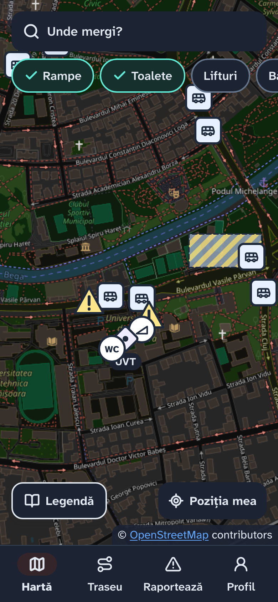
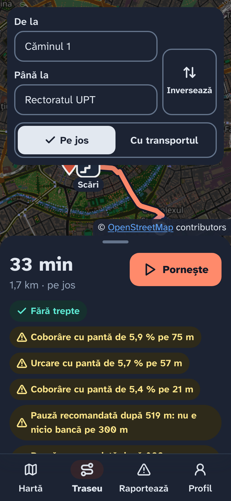
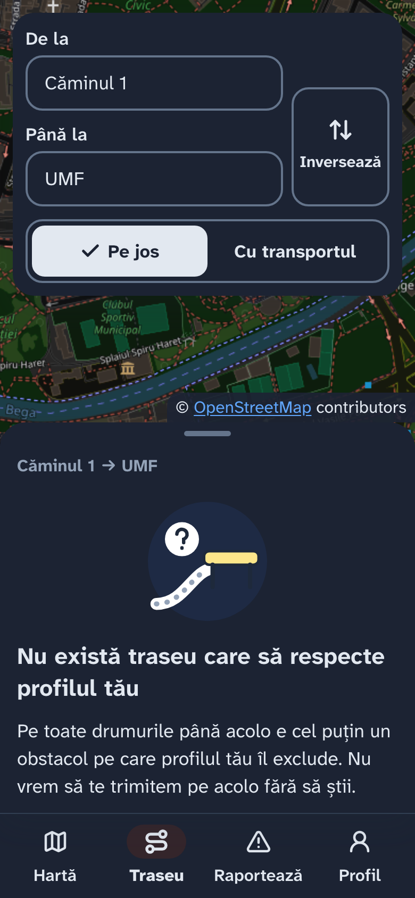
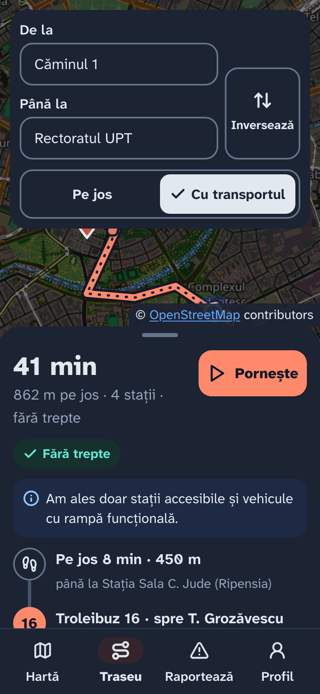
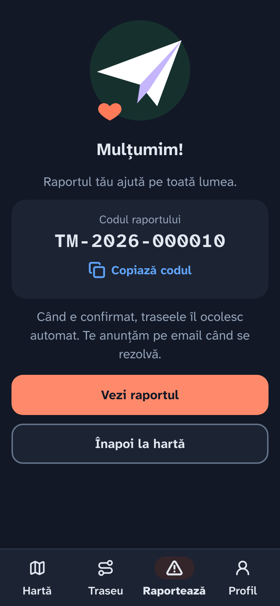
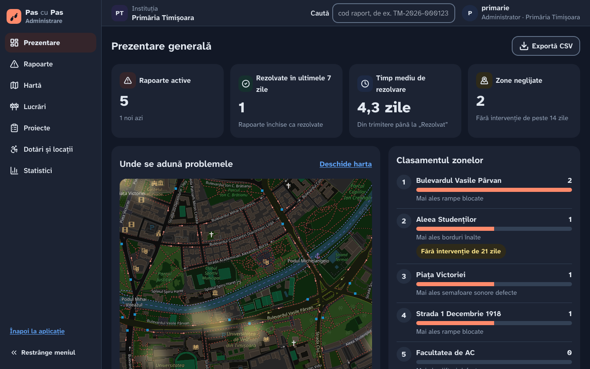

# Pas cu Pas — navigare accesibilă în Timișoara

Aplicație web, optimizată pentru telefon, care calculează trasee accesibile și te ghidează pas cu
pas în zona Complexului Studențesc și a universităților din jur (UVT, UPT, UMF). Traseele țin cont
de profilul tău de nevoi: scaun cu rotile, vedere slabă, auz slab, indicații simple, oboseală,
cărucior sau accidentări temporare.

- **Hartă cu dotări:** rampe, lifturi, toalete, parcări, ghidaje tactile, semafoare sonore, bănci,
  stații; problemele active apar ca alerte, iar lucrările ca zone hașurate.
- **Rutare și navigare:** A* pe graful propriu de trotuare, pe jos sau cu o linie STPT; navigare
  în timp real cu indicații vocale, vibrații și recalculare când ieși de pe traseu.
- **Raportare:** problemă cu poză și locație, cod public `TM-2026-000123`, deduplicare la 25 m,
  grad de încredere al utilizatorilor.
- **Administrare:** rapoarte cu scorul verificării automate, lucrări, proiecte, dotări, străzi,
  vehicule, statistici cu hartă termică, utilizatori și instituții.

| Hartă | Traseu spre Rectorat | Fără traseu accesibil |
|---|---|---|
|  |  |  |

| Transport public | Raport trimis | Administrare |
|---|---|---|
|  |  |  |

## Arhitectura

```
frontend/  React + Vite + Leaflet ── HTTPS, JSON, token JWT ──┐
                                                              ▼
backend/   FastAPI (un singur worker: graful de străzi stă în memorie)
           auth · users · places · routes · transit · reports · admin
                                                              │
           PostgreSQL 16 + PostGIS  ◄─────────────────────────┘
           scripts/: import_osm (străzi), import_gtfs (STPT), seed_fake (date demo)
```

Aplicația utilizatorului și panoul de administrare sunt în același proiect React; adminul e pe
rutele `/admin/...`, cu layout separat. Documentația API, generată de FastAPI:
<http://localhost:8000/docs>.

## Pornire locală

Ai nevoie de Docker, [uv](https://docs.astral.sh/uv/) și Node.js 20+.

**1. Baza de date și serverul de email de test** (PostGIS pe 5432, Mailpit pe 8025):

```bash
docker compose up -d
```

**2. Setările.** Copiază `.env.example` în `.env` și completează `JWT_SECRET`:

```bash
cp .env.example .env
python3 -c "import secrets; print(secrets.token_hex(32))"
```

**3. Backendul**, din folderul `backend/`:

```bash
uv sync
uv run alembic upgrade head
uv run --group data python -m scripts.import_osm   # străzile din OpenStreetMap (o singură dată)
uv run python -m scripts.import_gtfs               # stațiile, liniile și orarul STPT
uv run python -m scripts.seed_fake                 # atribute fictive, conturi și scenarii demo
uv run uvicorn app.main:app --env-file ../.env --workers 1 --reload
```

**4. Frontendul**, din folderul `frontend/`:

```bash
npm ci
cp .env.example .env.local   # VITE_USE_MOCKS=false: vorbește cu backendul prin /api
npm run dev
```

Aplicația e la <http://localhost:5173>, emailurile de test la <http://localhost:8025>.

Fără backend, frontendul merge și singur, pe date de exemplu: pune `VITE_USE_MOCKS=true` în
`frontend/.env.local`. Apare banda „Mod demo”, iar parola conturilor de mai jos e `parola-demo1`.

### Conturi demo

Create de `scripts/seed_fake.py`, toate cu parola **`parola-demo1`** (doar pentru baza locală):

| Cont | Rol |
|---|---|
| `andreea@exemplu.ro` | utilizator, încredere 100%, profil pentru scaun cu rotile |
| `mihai@exemplu.ro` | utilizator, încredere 50% |
| `primarie@exemplu.ro` | admin, Primăria Timișoara |
| `stpt@exemplu.ro` | admin, operatorul de transport STPT |

Primul superadmin se creează separat; parola se cere în terminal:

```bash
uv run python -m scripts.create_superadmin --email adresa@ta.ro
```

### Înainte de demo

Cu backendul oprit, din `backend/`, readu baza la datele demo (șterge conturile și rapoartele
de test, reimportă străzile și orarul, păstrează superadminii):

```bash
uv run --group data python -m scripts.demo_reset --da
```

SMTT publică orarul pe perioade. Dacă demo-ul cade înainte sau după perioada din fișierul GTFS,
`import_gtfs` folosește pentru zilele din jurul lui orarul aceleiași zile a săptămânii din fișier.
Pentru altă zi decât azi: `uv run python -m scripts.import_gtfs --replace --zi-demo 2026-11-20`.

### Test pe telefon

Browserul dă acces la GPS doar pe HTTPS. Pornește frontendul cu `VITE_API_URL=/api` (cererile
merg la backend prin proxy-ul Vite) și deschide un tunel spre el:

```bash
cloudflared tunnel --url http://localhost:5173
```

Pe telefon, deschide adresa `https://….trycloudflare.com` afișată de comandă.

## Teste

```bash
cd backend && uv run ruff check . && uv run pytest     # pe baza separată navigare_test
cd frontend && npm test && npm run build
```

GitHub Actions rulează aceleași verificări la fiecare PR (`.github/workflows/ci.yml`).

## Date

| Date | Sursă | Real sau fictiv |
|---|---|---|
| Trotuare și străzi | © OpenStreetMap contributors, prin `osmnx` | real |
| Pante, borduri, suprafețe, trepte, ghidaje | `seed_fake.py` + scenarii scrise de mână | fictiv |
| Rampe, toalete, parcări, bănci, clădiri | OpenStreetMap, completat cu date fictive | mixt |
| Stații, linii, orar | GTFS publicat de SMTT pentru rețeaua STPT | real |
| Dotările vehiculelor | `import_gtfs.py` | fictiv |
| Lucrări și proiecte ale primăriei | introduse din panoul de administrare | fictiv |
| Căutarea de adrese | locațiile proprii + Nominatim (OpenStreetMap) | real |

Tile-urile hărții: © OpenStreetMap contributors. Orarul: Societatea Metropolitană de Transport
Timișoara (SMTT) / STPT.

---

© 2026 20SOFT
